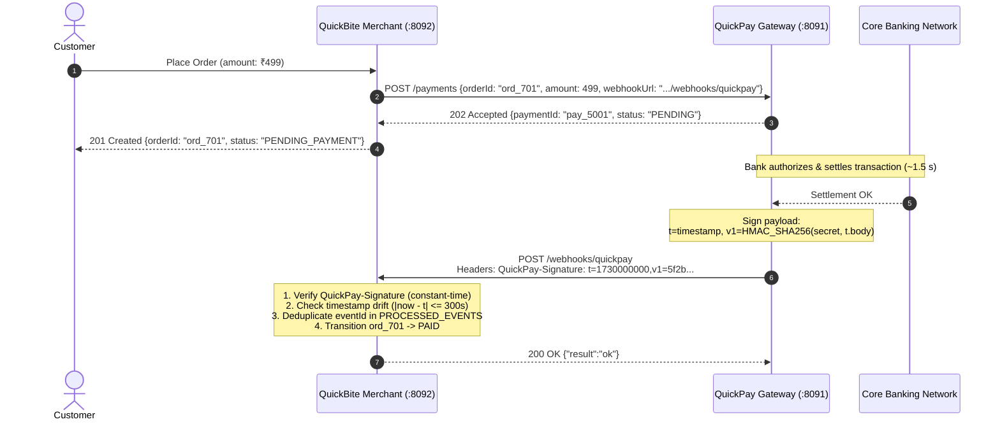
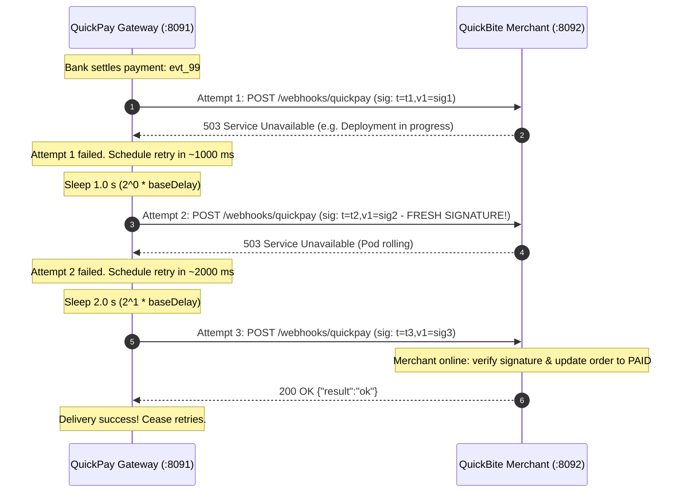
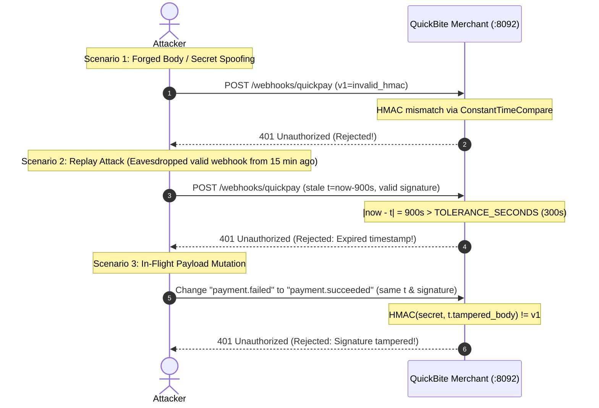
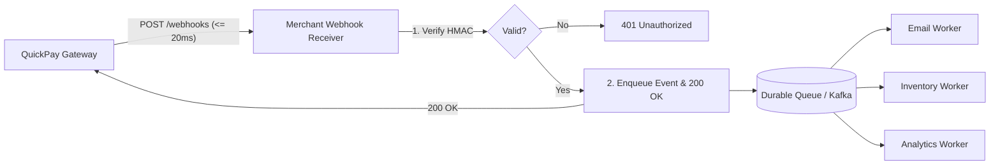

# Exercise 05 — Webhooks: Sending & Receiving (Answers & Implementation)

A production-grade implementation and comprehensive system design analysis of **Webhooks (Server-to-Server Event Callbacks)**, covering HMAC-SHA256 signature generation/verification, replay attack prevention, exponential backoff retries with jitter, at-least-once delivery semantics, and idempotent consumer architectures for the QuickBite / QuickPay platform.

---

## 1. The Story & System Overview

In prior exercises, clients pulled or streamed data from a centralized server:
- **Exercise 01 (REST):** Client initiated discrete HTTP requests.
- **Exercise 02 (Polling):** Client repeatedly queried the server (short/long polling).
- **Exercise 03 (SSE):** Client opened a long-lived HTTP GET stream to receive push updates.
- **Exercise 04 (WebSockets):** Client and server established full-duplex TCP framing.

In **Exercise 05 (Webhooks)**, the architecture shifts to **server-to-server asynchronous integration**:
When a customer places an order on QuickBite, QuickBite charges the customer through **QuickPay** (a Stripe/Razorpay-like payment gateway). Card authorization and banking network settlement take non-deterministic time (1–3 seconds or more). 

Blocking the merchant HTTP request while waiting for the bank would exhaust web worker threads, tie up connection pools, and degrade customer experience. Instead, QuickPay acknowledges the charge immediately with **`202 Accepted`** and informs QuickBite: *"Don't call us, we'll call you."*

When the banking network finishes settling the charge, QuickPay makes an outbound **HTTP POST callback (Webhook)** directly to QuickBite's receiver endpoint.

Because webhooks operate over the public internet between independent servers, two fundamental engineering challenges arise:
1. **Security & Authenticity:** Anyone can send an HTTP POST to QuickBite's webhook endpoint. QuickBite must mathematically verify that every incoming event originated from QuickPay and was not tampered with in transit.
2. **Reliability & Idempotency:** Networks fail, deploy pipelines restart merchant pods, and gateways retry failed calls. Gateways guarantee **at-least-once delivery**, which inevitably produces duplicate deliveries and out-of-order events. The merchant receiver must be strictly idempotent.

---

### Sequence Diagrams

#### A. Standard End-to-End Payment Flow


#### B. Network Flakiness, Exponential Backoff & Jittered Retries


#### C. Threat Model & Replay Attack Defense


---

## 2. API Contract & Endpoint Design

### QuickPay Payment Gateway (`http://localhost:8091`)

| Method | Path | Request Body / Params | Success | Failure | Notes & Semantics |
|---|---|---|---|---|---|
| `POST` | `/payments` | `{"orderId":"ord_..", "amount":499, "webhookUrl":"http://..."}` | **202 Accepted** | 400 | Registers pending charge; schedules bank settlement in ~1.5 s. |
| `GET` | `/payments/{id}` | Path param: `paymentId` | **200 OK** | 404 | Payment entity snapshot (the pull fallback used for reconciliation). |
| `GET` | `/deliveries` | None | **200 OK** | — | Audit trail of every webhook delivery attempt, status code, latency, and timestamp. |
| `GET` | `/` | None | **200 OK** | — | Service discovery ping endpoint. |

### QuickBite Merchant App (`http://localhost:8092`)

| Method | Path | Request Body / Headers | Success | Failure | Notes & Semantics |
|---|---|---|---|---|---|
| `POST` | `/orders` | `{"amount":499}` | **201 Created** | 400, 502 | Creates order, asks QuickPay to charge, returns `PENDING_PAYMENT`. |
| `GET` | `/orders/{id}` | Path param: `orderId` | **200 OK** | 404 | Retrieves live order state (`PENDING_PAYMENT` $\to$ `PAID` / `PAYMENT_FAILED`). |
| `POST` | `/webhooks/quickpay` | Headers: `QuickPay-Signature: t=..,v1=..`<br/>Body: `{"id":"evt_..","type":"..","data":{..}}` | **200 OK** | 400, 401, 503 | Validates signature and timestamp; idempotently applies order transition. |
| `GET` | `/stats` | None | **200 OK** | — | Real-time counters: `received`, `duplicatesIgnored`, and `rejected`. |

---

## 3. Implementation Blueprint (The 5 Core TODOs)

### TODO 1: Gateway Signature Generation (`PayGateway.signatureHeader`)
To ensure origin authenticity and payload integrity, QuickPay signs every outgoing webhook payload using HMAC-SHA256:
$$\text{Signature} = \text{HMAC-SHA256}(K_{\text{secret}}, \text{timestamp} \mathbin{\Vert} \text{"."} \mathbin{\Vert} \text{rawBody})$$
The header is formatted as:
`QuickPay-Signature: t=1730000000,v1=5f2b...e1`

```java
static String signatureHeader(String body, long unixSeconds) {
    String message = unixSeconds + "." + body;
    return "t=" + unixSeconds + ",v1=" + hmacHex(WEBHOOK_SECRET, message);
}
```

### TODO 2: Gateway Exponential Backoff Retries (`PayGateway.deliverWithRetries`)
Transient failures (network blips, pod restarts, timeouts) are inevitable. The gateway retries up to `MAX_ATTEMPTS = 5` times with exponential delay gaps ($1\,\text{s}, 2\,\text{s}, 4\,\text{s}, 8\,\text{s}$):
$$T_{\text{delay}}(k) = 1000 \times 2^{k-1} \text{ ms}$$

Key requirements:
1. **Fresh Signature:** Sign on *every* retry attempt so the timestamp $t$ remains fresh and is not rejected as stale by the merchant's replay window.
2. **Timeout Enforcement:** Request timeout is set to 5 seconds (`Duration.ofSeconds(5)`). Slow receivers count as failures.
3. **Attempt Auditing:** Every attempt is recorded via `recordAttempt(eventId, attempt, result)`.

```java
static void deliverWithRetries(String url, String eventId, String json) {
    long delayMs = 1000;
    for (int attempt = 1; attempt <= MAX_ATTEMPTS; attempt++) {
        long nowSec = System.currentTimeMillis() / 1000;
        String signature = signatureHeader(json, nowSec);
        try {
            HttpRequest request = HttpRequest.newBuilder(URI.create(url))
                    .timeout(Duration.ofSeconds(5))
                    .header("Content-Type", "application/json")
                    .header("QuickPay-Signature", signature)
                    .POST(HttpRequest.BodyPublishers.ofString(json))
                    .build();

            HttpResponse<String> response = HTTP.send(request, HttpResponse.BodyHandlers.ofString());
            int status = response.statusCode();
            recordAttempt(eventId, attempt, status);
            if (status >= 200 && status < 300) return;
        } catch (Exception e) {
            recordAttempt(eventId, attempt, e.getMessage() != null ? e.getMessage() : e.getClass().getSimpleName());
        }
        if (attempt < MAX_ATTEMPTS) {
            try { Thread.sleep(delayMs); } catch (InterruptedException e) { return; }
            delayMs *= 2;
        }
    }
}
```

### TODO 3: Signature & Replay Verification (`MerchantApp.receiveWebhook`)
Before processing any data, the merchant validates three security gates:
1. **Header Validation:** Ensure `QuickPay-Signature` exists and contains both `t` and `v1`.
2. **Replay Window Check:** Reject any request where $|\text{now} - t| > \text{TOLERANCE\_SECONDS}$ (5 minutes). This prevents captured valid requests from being replayed indefinitely.
3. **Constant-Time Verification:** Recompute $\text{HMAC-SHA256}(K_{\text{secret}}, t \mathbin{\Vert} \text{"."} \mathbin{\Vert} \text{rawBody})$ and compare it against $v_1$ using `MessageDigest.isEqual` (or Go's `subtle.ConstantTimeCompare`) to prevent timing side-channel attacks. Any mismatch immediately aborts with `401 Unauthorized`.

### TODO 4: Idempotent Event Deduplication (`MerchantApp.receiveWebhook`)
Because gateways deliver *at-least-once*, duplicate events **will** arrive (network timeouts where the merchant processed the event but the ACK dropped, or gateway duplicate mode).
- The merchant tracks processed event IDs in an atomic set: `PROCESSED_EVENTS.add(eventId)`.
- If the event was already processed, increment `DUPLICATES` and return **`200 OK`**.
- **Crucial Rule:** Return `200 OK`, **never** `409 Conflict` or `4xx/5xx`, because any non-2xx status code instructs the gateway to keep retrying the duplicate!

### TODO 5: Event Application & Order Mutation (`MerchantApp.receiveWebhook`)
Extract `data.orderId` and transition the order:
- `payment.succeeded` $\longrightarrow$ `status = "PAID"`
- `payment.failed` $\longrightarrow$ `status = "PAYMENT_FAILED"`
- Unknown order ID $\longrightarrow$ Log warning, but still reply **`200 OK`** (retrying will not resurrect an order that does not exist in the database).
- Reply immediately with `200 OK {"result":"ok"}`. Heavy asynchronous jobs (e.g. sending confirmation emails or notifying kitchens) must be queued in the background.

---

## 4. Think & Answer (In-Depth Technical Analysis)

### 1. Webhook vs the merchant polling `GET /payments/{id}`. Why do gateways offer both? When do you need the poll anyway?
* **Why Gateways Offer Both:**
  * **Webhooks (Push):** Optimal for the happy path. They provide sub-second latency ($0\text{ ms}$ idle delay), reduce infrastructure load by eliminating millions of wasteful poll requests, and scale efficiently for both parties.
  * **Polling (Pull):** Serves as an indispensable safety net and fallback channel. Webhooks are "fire-and-forget" over arbitrary networks; if the merchant server experiences an extended outage, firewall misconfiguration, or DNS failure, all gateway retries will eventually exhaust.
* **When Polling Is Required:**
  1. **Exhausted Retries (Dead Letter Recovery):** If a merchant pod is down during a 15-minute deployment and misses all 5 retries, the merchant's background reconciliation cron polls `GET /payments/{id}` for all orders stuck in `PENDING_PAYMENT` to self-heal.
  2. **Synchronous User Flow Fallback:** When a customer completes payment on their phone and returns to the merchant app before the asynchronous webhook arrives over the internet, the frontend can query `GET /orders/{id}` or the backend can poll `GET /payments/{id}` to display the receipt without delay.
  3. **Discrepancy Auditing:** Nightly batch settlement jobs poll payment states to ensure merchant ledgers match gateway balances.

---

### 2. Why HMAC and not just a secret token in a header like `X-Secret: abc`? What does HMAC prove that a token doesn't?
* **Origin Authenticity vs. Payload Integrity:**
  * A static bearer token (`X-Secret: abc`) proves **only origin** (that the caller knows the secret). It provides **zero protection against payload tampering**.
  * An attacker performing a Man-in-the-Middle (MitM) attack or a compromised proxy could inspect the request, keep `X-Secret: abc`, but alter the body from:
    ```json
    {"type": "payment.failed", "data": {"orderId": "ord_99"}}
    ```
    to:
    ```json
    {"type": "payment.succeeded", "data": {"orderId": "ord_99"}}
    ```
    The merchant inspecting only `X-Secret` would accept the forged payload and release goods for free!
* **Cryptographic Commitment:**
  HMAC ($\text{Hash-based Message Authentication Code}$) computes a cryptographic hash over the secret **and the exact body bytes**. Any single-bit modification to the body generates a completely different hash ($2^{256}$ search space). Thus, HMAC proves two things simultaneously:
  1. The sender possesses the shared secret ($K_{\text{secret}}$).
  2. The payload bytes received by the merchant are identical byte-for-byte to what the gateway dispatched.

---

### 3. Why is the timestamp inside the signed message? What attack does `TOLERANCE_SECONDS` stop?
* **The Threat: Replay Attacks:**
  Suppose an attacker cannot break HMAC-SHA256, but can eavesdrop on network traffic or access historical access logs. The attacker captures a legitimate, authentic webhook from 2 weeks ago where a customer paid ₹1,000. If the attacker replays that identical packet to `/webhooks/quickpay`, the signature matches the body perfectly!
* **Why the Timestamp Must Be Signed:**
  By signing $\text{timestamp} \mathbin{\Vert} \text{"."} \mathbin{\Vert} \text{body}$, the timestamp is bound cryptographically to the signature:
  1. If an attacker attempts to update the timestamp to the current time, the HMAC becomes invalid because the attacker lacks $K_{\text{secret}}$.
  2. If the attacker leaves the original timestamp untouched, the merchant calculates $|t_{\text{current}} - t_{\text{signed}}| = 14 \text{ days} > 300\text{ seconds}$ and immediately drops the request with **401 Unauthorized**.

---

### 4. Why `MessageDigest.isEqual` (or `subtle.ConstantTimeCompare`) instead of `String.equals`?
* **The Vulnerability: Timing Side-Channel Attacks:**
  Standard string equality operators (`String.equals` in Java, `==` in Go or Python) perform **short-circuit evaluation**: they compare characters sequentially from index $0$ to $N$ and return `false` on the very first mismatched byte.
* **How an Attacker Exploits Short-Circuiting:**
  1. An attacker sends a forged signature starting with `00...`. The server compares character 0, sees a mismatch, and returns 401 in $1.02 \ \mu\text{s}$.
  2. The attacker tries `01...`, `02...`, until trying `5f...`. Because byte 0 matches, the loop proceeds to byte 1 before exiting, taking $1.08 \ \mu\text{s}$.
  3. By measuring nanosecond response latency over thousands of requests, an attacker can determine each character of the signature one by one, bypassing the $2^{256}$ cryptographic security space in a few thousand requests.
* **The Solution:**
  `MessageDigest.isEqual` and `subtle.ConstantTimeCompare` execute in **strict $\mathcal{O}(N)$ time**: they iterate through all bytes regardless of where differences occur, eliminating timing variations.

---

### 5. Why must you verify against the raw body bytes, not re-serialized JSON?
* **JSON Canonicalization Non-Determinism:**
  JSON is an abstract data serialization format, not a canonical byte specification. The following JSON documents represent the exact same semantic data:
  ```json
  {"id":"evt_1","status":"PAID"}
  ```
  ```json
  {
    "status": "PAID",
    "id": "evt_1"
  }
  ```
* **Byte-Level Sensitivity of Cryptographic Hashes:**
  SHA-256 operates on raw binary byte sequences ($0\text{x}00 \dots 0\text{xFF}$). A single extra space, a different key ordering, or Windows vs Unix newline formatting (`\r\n` vs `\n`) causes the avalanche effect, completely changing the output hash.
* If a server parses the request into a map or object and re-serializes it back to JSON to verify the signature, the serializer will change key ordering or whitespace, resulting in a false-positive signature verification failure.

---

### 6. On a duplicate, why answer `200 OK` and not `409 Conflict`?
* **Gateway Retry Contract:**
  Payment gateways operate under the standard HTTP delivery contract:
  * **2xx (200, 201, 202, 204):** Event acknowledged and delivered. Stop retrying.
  * **Non-2xx (4xx, 5xx, timeouts):** Delivery failed. Keep retrying with exponential backoff until `MAX_ATTEMPTS` is reached.
* **The Infinite Retry Storm:**
  If the merchant returns `409 Conflict` on a duplicate, the gateway treats `409` as an error. It will back off and retry the duplicate event again, receiving `409` repeatedly until exhausting all attempts.
* Returning **`200 OK`** signals to the gateway: *"I have safely and durably recorded this event. Do not send it again."*

---

### 7. Your handler takes 8 s because it also sends a confirmation email. What goes wrong with the gateway's 5 s timeout? How do you fix it?
* **What Goes Wrong:**
  1. At $t = 5\text{ s}$, the gateway's client timeout triggers, closing the socket and logging attempt 1 as `TIMEOUT`.
  2. At $t = 8\text{ s}$, the merchant finishes sending the email and marks the order as paid.
  3. Because the gateway registered a timeout, it retries at $t = 6\text{ s}$. The merchant receives attempt 2, spends *another* 8 seconds, sends a *second* confirmation email to the customer, and times out again!
* **The Fix: Decouple Ingestion from Processing (Queue Architecture):**
  A webhook handler must perform only two operations synchronously:
  1. Verify the signature and timestamp ($< 1\text{ ms}$).
  2. Persist the raw event to an append-only transactional event log or publish it to a durable message broker (Kafka, AWS SQS, RabbitMQ, Redis Streams).
  3. Respond immediately with **`200 OK`** ($< 20\text{ ms}$).
  An asynchronous background worker pool consumes from the queue to send confirmation emails, generate invoices, and notify third parties.



---

### 8. `payment.failed` arrives *after* `payment.succeeded` for the same order (retries reorder things). What should happen? How would you guard against it?
* **Why Reordering Happens:**
  Suppose `payment.failed` is generated first, but hits network congestion and retry backoff. A subsequent transaction or retry lands `payment.succeeded` first. The delayed `payment.failed` packet arrives 5 seconds later.
* **What Should Happen:**
  The system must recognize `PAID` as a **terminal success state**. The subsequent `payment.failed` event must be safely ignored or logged as an out-of-order anomaly. Under no circumstances should an order flip from `PAID` to `PAYMENT_FAILED`.
* **How to Guard Against It:**
  1. **Monotonic State Machine:** Define legal state transitions. Once an order enters `PAID`, transitions to `PAYMENT_FAILED` are strictly forbidden.
     $$\text{PENDING} \longrightarrow \text{PAID} \quad (\text{terminal})$$
     $$\text{PENDING} \longrightarrow \text{PAYMENT\_FAILED} \longrightarrow \text{PAID} \quad (\text{allowed via retry})$$
     $$\text{PAID} \mathrel{\centernot\longrightarrow} \text{PAYMENT\_FAILED} \quad (\text{illegal})$$
  2. **Event Versioning / Monotonic Sequence Numbers:** The gateway includes a monotonically increasing `version` or state timestamp in the payload. The merchant applies an update only if:
     $$\text{event.version} > \text{order.currentVersion}$$

---

## 5. Stretch Goals & Production Hardening

### 1. Jittered Exponential Backoff (Thundering Herd Prevention)
When hundreds of webhooks fail simultaneously (e.g. during a merchant database blip), fixed exponential backoff causes all retrying gateway workers to hit the merchant simultaneously in synchronized spikes ($1\text{s}, 2\text{s}, 4\text{s}$), knocking the merchant down repeatedly.

**Full Jitter Algorithm:**
$$T_{\text{sleep}} = \text{random}(0, \text{delay}) \quad \text{or} \quad \text{delay} \times \text{random}(0.5, 1.5)$$
Jitter uniformly flattens retry traffic across time, allowing the recovering merchant to absorb the backlog smoothly.

### 2. Durable Deduplication with TTL Eviction
In-memory sets grow unboundedly over time. In production:
- Event IDs are stored in a distributed Redis cache or relational database with a **7-day TTL**:
  ```sql
  CREATE TABLE processed_webhook_events (
      event_id VARCHAR(64) PRIMARY KEY,
      received_at TIMESTAMP WITH TIME ZONE DEFAULT NOW(),
      expires_at TIMESTAMP WITH TIME ZONE DEFAULT (NOW() + INTERVAL '7 days')
  );
  ```
- Because gateways guarantee retry termination within 24–72 hours, a 7-day TTL guarantees complete duplicate protection while maintaining bounded memory consumption.

### 3. Automated Reconciliation Worker (Self-Healing Cron)
The merchant runs a background reconciler every 30 seconds:
- Queries orders stuck in `PENDING_PAYMENT` for $> 60\text{ seconds}$.
- Queries QuickPay `GET /payments/{paymentId}` directly.
- Automatically marks missing orders as `PAID` or `PAYMENT_FAILED`, ensuring zero orders are lost even if webhooks fail completely.

---

## 6. Verification & Test Suite

### Java Verification Suite
Run all three terminals:
```bash
# Terminal 1: Payment Gateway
java PayGateway.java

# Terminal 2: Merchant Receiver
java MerchantApp.java

# Terminal 3: Test Harness
java Check.java
```

### Go Verification Suite
Run the complete unit, security, and integration test suite:
```bash
go test -v ./...
```

Expected test execution output:
```text
=== RUN   TestGatewaySignatureFormat
--- PASS: TestGatewaySignatureFormat (0.00s)
=== RUN   TestGatewayDeliverWithRetries
--- PASS: TestGatewayDeliverWithRetries (2.41s)
=== RUN   TestMerchantSignatureVerification
--- PASS: TestMerchantSignatureVerification (0.00s)
=== RUN   TestMerchantIdempotencyAndApplication
--- PASS: TestMerchantIdempotencyAndApplication (0.00s)
=== RUN   TestEndToEndFlow
--- PASS: TestEndToEndFlow (0.26s)
=== RUN   TestFlakyMerchantRecovery
--- PASS: TestFlakyMerchantRecovery (0.36s)
=== RUN   TestCheckJavaParity
--- PASS: TestCheckJavaParity (9.36s)
PASS
ok      quickbite-webhooks      13.071s
```

---

## 7. Chaos & Resilience Testing

To verify resilience against real-world production failures, execute the built-in chaos modes:

```bash
# Gateway chaos: Dispatches every webhook event twice
go run main.go --gateway --duplicate

# Merchant chaos: Fails the first 2 webhook attempts with HTTP 503
go run main.go --merchant --flaky
```

Monitor the logs and delivery stats in real time:
```bash
# Inspect merchant counters (duplicates caught and rejected forged requests)
curl -s http://localhost:8092/stats | jq .

# Inspect gateway retry delivery attempts
curl -s http://localhost:8091/deliveries | jq .
```
